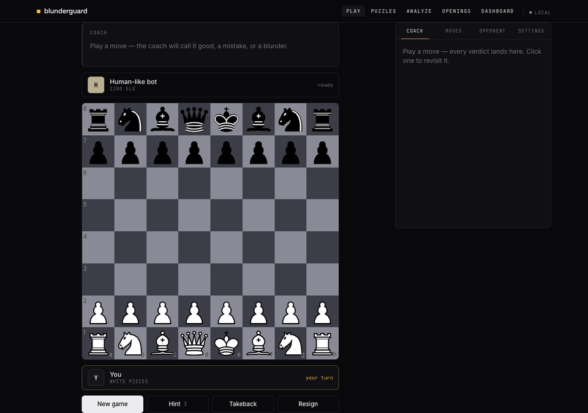

# Blunder Guard

Chess training app: Elo bots, live blunder coach, puzzles, analysis — and a
**human-like bot trained on 3.2M moves from real Lichess games**, running in
your browser.



<sub>A real game against the 1200 human-like bot. 1.e4 is fine. 2.Ba6 hangs the bishop, so the blunder check stops the move first; played anyway, the coach names the problem and draws the engine's move. The bot's replies are sampled, so each run plays out a little differently.</sub>

## A bot that plays like a real person

Practice bots are usually Stockfish turned down, and their mistakes feel
random. So I measured it. I recreated the app's original bots exactly, ran
them on 4,298 positions from real games, and counted how often each played the
move the human actually played. Then I trained a model to do better.


| | Top choice | As a bot (sampled) |
|---|---|---|
| Random legal move | — | 6.8% |
| Original Stockfish bots | — | 25.5% |
| Stockfish best move | 36.8% | — |
| **Trained model** | **40.9%** | **29.9%** |

<sub>4,298 positions from October 2026 Lichess games, 300 per 100-Elo band from 600 to 1900, plus 98 at 2000. The model was trained on September games only. At 2000 Elo (98 positions) Stockfish's best move matches better: 46% vs 38%.</sub>

- **The original bots were less human than plain Stockfish at every rating.**
  Picking randomly among the engine's top lines doesn't make mistakes look
  human; it makes moves nobody plays.
- **One network for every rating.** The player's Elo is an input, so the same
  0.5M-parameter ResNet plays like a 600 or a 1900. It does best at low
  ratings: 34% at 600 Elo, against 17% for the old bot.
- **No leakage, and it generalises.** Train/val is split by game, and the test
  set is a later month: 41.2% on held-out September games, 40.9% in October.
- **Runs in the browser.** Exported to ONNX (2 MB) and run with
  onnxruntime-web in a Web Worker: about 1.3 ms per move, under 4 ms at worst.
  Browser outputs match PyTorch's top move on 60 of 60 checked positions.

Pick **Opponent → Human-like** on the play screen. The data pipeline,
training and evaluation are in [`ml/`](./ml); the reasoning behind each step is
in the [learning log](./docs/LEARNING_LOG.md).

## The coach

Stockfish does the judging and the language model only does the wording, because LLMs are bad at calculating chess.

- **Blunder check, before the move.** When you drop a piece, Stockfish checks the move at depth 8 (about 150 ms). If it loses 3 pawns or more, the move is held and you get the three questions: is my piece safe, are their pieces hanging, is my king safe. It never tells you the better move at this point; you can take another look or play it anyway.
- **A verdict after every move.** Stockfish evaluates the position before and after at depth 12. A drop of 0.5 pawns is an inaccuracy, 1 is a mistake, 2 is a blunder. For those three, a detector names the reason, such as a hung piece, a missed capture or a back-rank mate, and "Show best move" draws the engine's move on the board.
- **The explanation can't invent moves.** The engine's move and line go to the model in normal notation. If the reply names any move that isn't the one you played, isn't in Stockfish's line and isn't legal in the position, it's thrown away and a written template is used instead. Without a model configured, templates are all you get, and they always work.

That last check exists because an earlier version told players to make impossible moves. Themes fired on good moves, a back-rank warning fired in the opening, and moves were shown in engine notation for the wrong side. Each case is now a unit test.

The rest of the app: rated puzzles that come back on a spaced-repetition schedule when you miss them, full-game analysis from a PGN with an eval graph and the three biggest mistakes, and an openings page for practising repertoire lines.

## Quick start

```bash
npm install
npm run dev
```

Open [http://localhost:3000/play](http://localhost:3000/play).

## Environment

Copy `.env.example` → `.env.local`.

**Fully local coach (no cloud keys):**

1. Install [Ollama](https://ollama.com)
2. `ollama pull llama3.2`
3. In `.env.local`: `LLM_PROVIDER=ollama`

Play, puzzles, analysis, and Stockfish all run in the browser with no network.
If Ollama is down, Explain falls back to built-in templates.

**Cloud (optional):** set `ANTHROPIC_API_KEY` / `GOOGLE_GENERATIVE_AI_API_KEY` and `LLM_PROVIDER=claude` or `gemini`.

## Scripts

| Command | Purpose |
|---|---|
| `npm run dev` | Local Next.js |
| `npm run build` | Production build |
| `npm run test:unit` | Unit tests, including the encoder parity check against the Python training code |
| `npm run test:smoke` | Playwright play-page smoke |

**ML** (Python 3.12, in `ml/`; `uv venv .venv && uv pip install -e ".[dev]" torch onnx onnxscript onnxruntime`):

| Command | Purpose |
|---|---|
| `python prepare_data.py --pgn <lichess .pgn.zst or URL> --out data/<month>` | Stream a Lichess dump into training shards |
| `python eval_baseline.py ...` | Move-match baseline for random, Stockfish, and the app's bots |
| `python train.py --data data/<month>` | Train the model (~32 min on an M5 MacBook Air) |
| `python eval_model.py ...` | Score a checkpoint on the same positions as the baseline |
| `python export_onnx.py ...` | Export to `public/models/`, check parity, write the TS fixture |
| `python make_chart.py ...` | Draw the README chart |
| `pytest` | 34 tests: encoding round-trips, pipeline, baseline maths, model |

## Docs

- [Architecture](./docs/ARCHITECTURE.md)
- [Learning log](./docs/LEARNING_LOG.md)
- Plans live in the parent `ChessTrainer/plans/` folder
